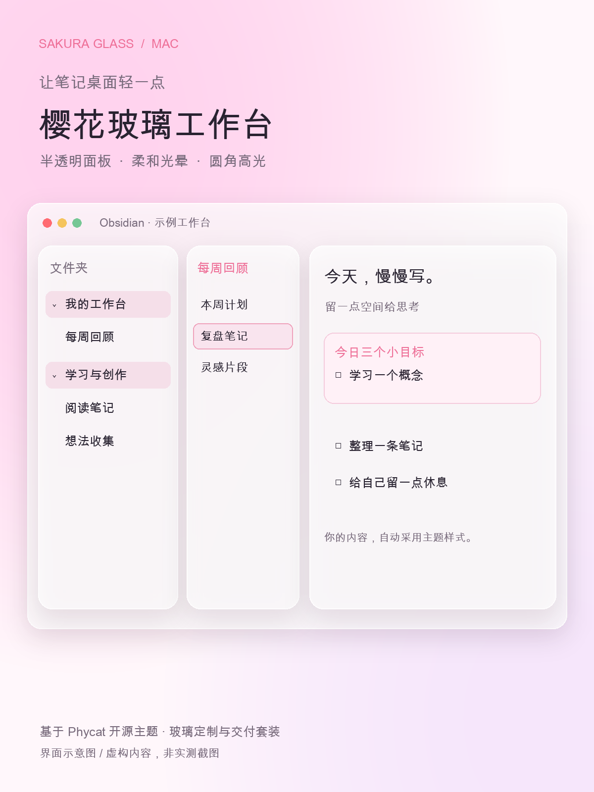

# Sakura Glass · 樱花玻璃工作台

一套基于 [Phycat](https://github.com/sumruler/obsidian-theme-phycat) 的 Obsidian Mac 定制外观。保留樱花粉，以半透明面板、粉紫静态光晕、圆角和边缘高光形成玻璃层次。

> Phycat 的原主题、配色与排版由 XuJilong 制作。本项目提供玻璃效果定制、通用分栏适配、文档及示例模板；不是 Phycat 官方版本，也不是从零开发的主题。

## 安装

下载 Releases 的主题包，将 `Sakura Glass` 文件夹放进你的配置目录 `themes/`，然后在 Obsidian「设置 → 外观 → 主题」选择 **Sakura Glass**。详见 [安装与回退](docs/安装与回退.md)。

- 支持 Obsidian 1.9.0+，主要针对 macOS 桌面；本次实测 macOS / Obsidian 1.14.4。
- 基础外观不依赖插件。安装可选的 Style Settings 后可调色、磨砂和透明度。
- 默认樱花粉 / 暗色 Vampire。保留通用 Power Explorer 组件；不会替你安装或改变导航插件。
- 主题能美化 Markdown。PDF 内页和图片像素不会被主题重排。
- 不含私人笔记、账户信息、第三方插件程序或工作区文件。

## 预览

`media` 中为使用虚构示例内容绘制的界面示意图，非性能测试截图。

## 用法与性能

[使用与性能](docs/使用与性能.md) · [自定义可视化看板适配](docs/自定义看板适配.md) · [变更记录](CHANGELOG.md) · [来源与改动](docs/来源与改动.md)

模糊仅作用于少数顶层面板，背景光晕不持续移动；没有扫描笔记的主题脚本。未进行内存、帧率和耗电对比测试。不要宣传“零占用”或“保证不卡”。

## 获取与商业交付

本仓库主题代码按 MIT 开放，可自行下载、修改和再分发。可收费提供的是整理好的安装套装、原创示例模板、说明及另行约定的安装服务；购买不获得排他代码授权。

## License & Credits

MIT。分发时保留 [LICENSE](LICENSE)、[第三方声明](THIRD-PARTY-NOTICES.md) 和 `licenses/`。感谢 Phycat / XuJilong 与 Lucide 等上游项目。
